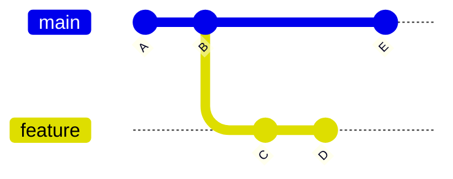
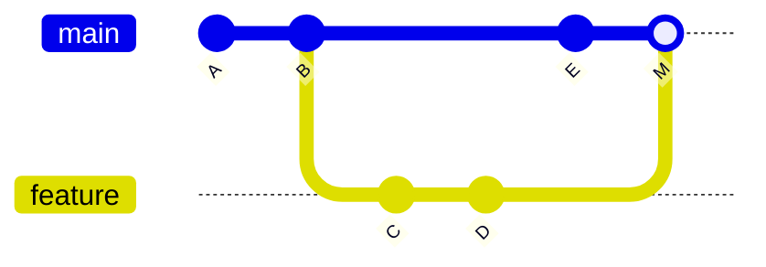
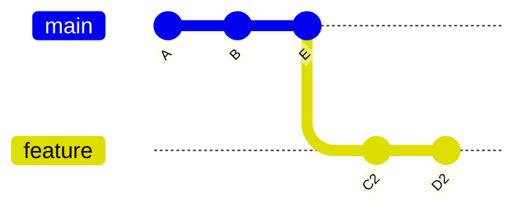
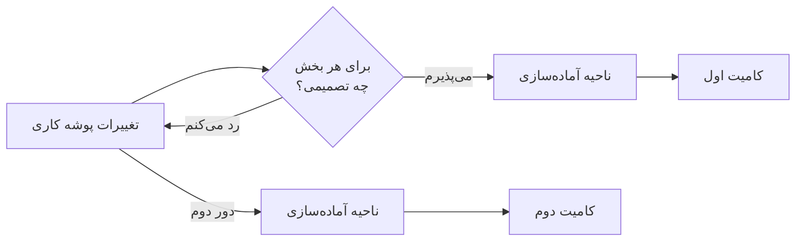
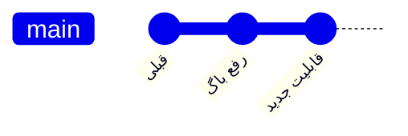
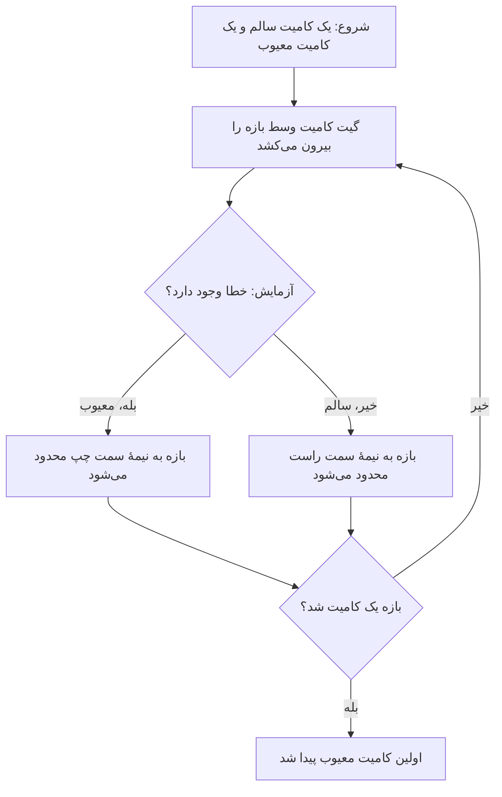
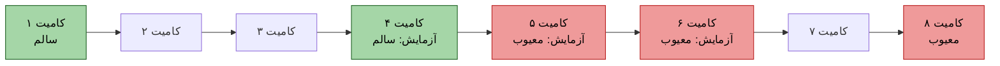
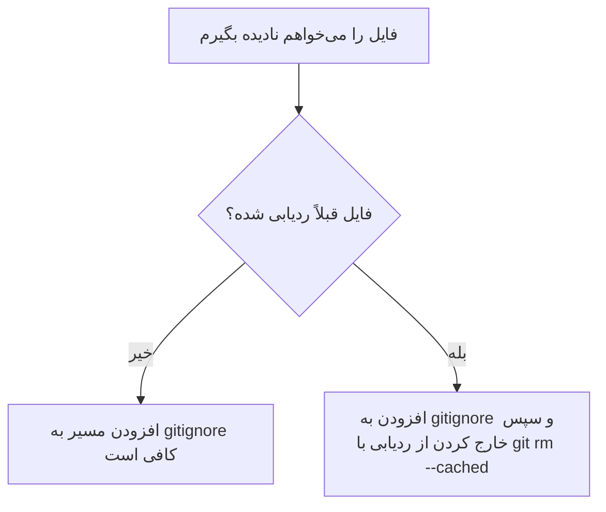
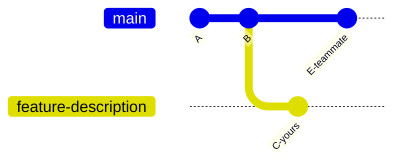
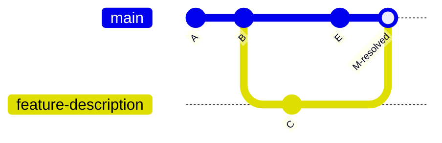

<div dir="rtl">

# سوال اول

## تفاوت `git merge` و `git rebase`

هر دو دستور `merge` و `rebase` برای ترکیب تغییرات یک شاخه با شاخه‌ی دیگه استفاده می‌شن، اما روش کارشون با هم فرق داره.

دستور `merge` دو مسیر تغییرات رو با یک **کامیت ادغام (Merge Commit)** به هم وصل می‌کنه و کامیت‌های قبلی رو تغییر نمی‌ده. به همین دلیل، تاریخچه‌ی پروژه **شاخه‌دار** باقی می‌مونه، اما مسیر واقعی تغییرات حفظ می‌شه و برای کار تیمی روش امنیه.

در مقابل، دستور `rebase` کامیت‌های شاخه‌ی خودمون رو برمی‌داره و اون‌ها رو روی آخرین کامیت شاخه‌ی مقصد **دوباره اعمال می‌کنه**. در نتیجه، کامیت‌های جدیدی با هش‌های متفاوت ساخته می‌شن و تاریخچه‌ی پروژه **خطی‌تر و مرتب‌تر** می‌شه؛ اما تاریخچه‌ی قبلی شاخه بازنویسی می‌شه.
**وضعیت اولیه:** شاخهٔ `feature` از `B` جدا شده و `main` در این فاصله کامیت `E` را گرفته است.

</div>



<div dir="rtl">

### `merge`: ساخت کامیت ادغام

</div>

```bash
git checkout main
git merge feature
```



<div dir="rtl">

**موقعیت:** ادغام شاخه‌ی تیمی `feature` در `main` (مثلاً با Pull Request).

**دلیل:** چون چند نفر روی این شاخه کار کردیم، بهتره از `merge` استفاده کنیم تا هش کامیت‌ها تغییر نکنه و تاریخچه‌ی کارمون حفظ بشه. همچنین، کامیت ادغام زمان ورود ویژگی به شاخه‌ی اصلی رو مشخص می‌کنه.
### `rebase`: انتقال کامیت‌ها به نوک مقصد

</div>

```bash
git checkout feature
git rebase main
```



<div dir="rtl">

**موقعیت:** وقتی می‌خوایم قبل از ساخت Pull Request، شاخه‌ی شخصی خودمون رو با آخرین تغییرات `main` به‌روز کنیم و هنوز هم اون رو push نکردیم.

**دلیل:** چون فقط خودمون روی این شاخه کار می‌کنیم، می‌تونیم از `rebase` استفاده کنیم تا تاریخچه‌ی کامیت‌ها مرتب و خطی بمونه و کامیت‌های اضافی Merge از `main` به وجود نیاد.

</div>

---

<div dir="rtl">

# سوال دوم

## بخش تغییرات و آماده‌سازی تعاملی در گیت

**بخش تغییرات** که در گیت بهش `hunk` می‌گیم، قسمتی از تغییرات یک فایل در خروجی دستور `git diff` هست. گیت تغییرات هر فایل رو به چند بخش جدا تقسیم می‌کنه و بالای هر بخش هم مشخص می‌کنه که تغییرات مربوط به کدوم قسمت فایل هستن. با دستور `git add -p` می‌تونیم هر بخش رو جداگانه بررسی کنیم و تصمیم بگیریم که وارد ناحیه‌ی آماده‌سازی (Staging Area) بشه یا نه. این کار باعث می‌شه اگه چند تغییر مستقل توی یک فایل انجام دادیم، بتونیم هر کدوم رو در یک **کامیت جداگانه و منسجم** ثبت کنیم.
### ساختار یک بخش تغییرات

</div>

```diff
@@ -10,6 +10,8 @@ def login(user):
     name = user.name
-    print("debug")
+    validate(user)
+    log_attempt(user)
     return name
```

<div dir="rtl">

سرتیتر `@@ -10,6 +10,8 @@` مشخص می‌کنه که در نسخه‌ی قدیمی، تغییرات از خط ۱۰ شروع می‌شن و ۶ خط رو شامل می‌شن، ولی در نسخه‌ی جدید از خط ۱۰ شروع می‌شن و ۸ خط رو در بر می‌گیرن. خطوطی که با علامت `-` شروع می‌شن، حذف شدن و خطوطی که با علامت `+` شروع می‌شن، به کد اضافه شدن. بقیه‌ی خطوط هم فقط برای این هستن که بتونیم محل تغییرات رو بهتر تشخیص بدیم و بهشون خطوط زمینه (Context) می‌گیم.

### دستور و انتخاب‌ها

</div>

```bash
git add -p
```

<div dir="rtl">

گیت هر بخش را نشان می‌دهد و این پرسش را می‌آورد:

</div>

```text
Stage this hunk [y,n,q,a,d,s,e,?]?
```

<div dir="rtl">

| کلید | کار |
|---|---|
| `y` | این بخش وارد ناحیهٔ آماده‌سازی شود |
| `n` | فعلاً نه |
| `s` | بخش به قطعه‌های کوچک‌تر تقسیم شود |
| `e` | بخش دستی و خط‌به‌خط ویرایش شود |
| `a` | همهٔ بخش‌های باقی‌ماندهٔ این فایل پذیرفته شود |
| `d` | همهٔ بخش‌های باقی‌ماندهٔ این فایل رد شود |
| `q` | خروج |
| `?` | نمایش راهنما |

اگه اشتباهی بخشی از تغییرات رو وارد ناحیه‌ی آماده‌سازی (Staging Area) کردیم، می‌تونیم از دستور `git reset -p` استفاده کنیم و اون بخش رو از حالت آماده‌سازی خارج کنیم. همچنین، قبل از کامیت بهتره با دستور `git diff --staged` تغییراتی رو که قراره ثبت بشن بررسی کنیم تا مطمئن بشیم فقط تغییرات موردنظرمون داخل کامیت قرار می‌گیرن.
### مراحل کار

</div>



<div dir="rtl">

### چرا مفید است؟

اگه توی یک فایل هم یه باگ رو برطرف کرده باشیم و هم یه قابلیت جدید اضافه کرده باشیم، با دستور `git add .` هر دو تغییر با هم وارد ناحیه‌ی آماده‌سازی می‌شن و معمولاً در یک کامیت ثبت می‌شن. اما با استفاده از آماده‌سازی تعاملی، می‌تونیم تغییرات رو از هم جدا کنیم و برای هر کدوم یک کامیت جداگانه بسازیم.
</div>



<div dir="rtl">

**مزایا:** با این روش، هر کامیت فقط یک هدف مشخص داره و بررسی تغییرات برای بقیه راحت‌تر می‌شه. همچنین، اگه بعداً بخوایم با دستور `git revert` یک تغییر رو برگردونیم، می‌تونیم این کار رو بدون تأثیر روی تغییر دیگه انجام بدیم. از طرفی، پیدا کردن باگ با دستور `git bisect` دقیق‌تر می‌شه. علاوه بر این، قبل از ثبت هر کامیت، یک بار تغییرات رو بررسی می‌کنیم و احتمال اینکه کدهای موقتی، مثل دستورهای چاپ برای اشکال‌زدایی، به‌اشتباه وارد کامیت بشن کمتر می‌شه.
</div>

---

<div dir="rtl">

# سوال سوم

## یافتن کامیت معیوب با دستور bisect

دستور `git bisect` با استفاده از **جست‌وجوی دودویی** توی تاریخچه‌ی پروژه، کمک می‌کنه کامیتی رو پیدا کنیم که باگ رو وارد پروژه کرده. برای این کار، یک کامیت **سالم** و یک کامیت **معیوب** مشخص می‌کنیم. بعد گیت کامیت وسط این بازه رو انتخاب می‌کنه و ما اون رو تست می‌کنیم و نتیجه رو به گیت می‌گیم که سالمه یا معیوب. گیت با توجه به نتیجه، هر بار نصف بازه رو کنار می‌ذاره و این روند ادامه پیدا می‌کنه تا در نهایت **اولین کامیتی که باعث ایجاد باگ شده** رو پیدا کنیم.
### مراحل کار

| مرحله | دستور | توضیح |
|---|---|---|
| ۱ | `git bisect start` | شروع جست‌وجو |
| ۲ | `git bisect bad` | کامیت فعلی معیوب است  |
| ۳ | `git bisect good v1.0` | این کامیت یا برچسب قطعاً سالم بوده است |
| ۴ | `git bisect good` یا `git bisect bad` | پس از آزمایش هر کامیتی که گیت بیرون می‌کشد، نتیجه را اعلام کنید |
| ۵ | `git bisect reset` | پایان کار و بازگشت به شاخهٔ اولیه |

وقتی گیت کامیتی رو که باعث ایجاد باگ شده پیدا کنه، پیامی با عبارت `is the first bad commit` نمایش می‌ده و مشخصات اون کامیت رو هم نشون می‌ده تا بفهمیم مشکل از کدوم تغییر به وجود اومده.
</div>



<div dir="rtl">

### مثال

فرض کنیم آزمون ورود به سیستم توی نسخه‌ی جدید خراب شده، ولی توی نسخه‌ی `v1.0` درست کار می‌کرده و بین این دو نسخه هم ۸ تا کامیت وجود داره. با استفاده از دستور `git bisect`، گیت کامیت‌های وسط این بازه رو بررسی می‌کنه و با هر بار تست، بخشی از کامیت‌ها رو کنار می‌ذاره تا در نهایت به کامیتی برسیم که باعث خراب شدن آزمون ورود به سیستم شده.
</div>



<div dir="rtl">

گیت اول کامیت ۴ رو بررسی می‌کنه که سالمه، بعد می‌ره سراغ کامیت ۶ که معیوبه و در نهایت کامیت ۵ رو آزمایش می‌کنه که اون هم معیوبه. چون کامیت ۴ سالم بوده و کامیت ۵ معیوب شده، پس **کامیت ۵ اولین کامیت معیوب** هست و تونستیم با سه بار آزمایش پیداش کنیم.

اگه بتونیم آزمایش رو با یک اسکریپت انجام بدیم، می‌تونیم کل فرایند رو خودکار کنیم. توی این حالت، اگه اسکریپت با کد خروجی `0` تموم بشه، یعنی کامیت سالمه و اگه کد خروجی غیر از `0` باشه، یعنی کامیت معیوبه.
</div>

```bash
git bisect start HEAD v1.0
git bisect run ./test.sh
```

<div dir="rtl">

### چرا مفید است؟
- **سرعت:** تعداد آزمایش‌ها به‌صورت لگاریتمی با تعداد کامیت‌ها افزایش پیدا می‌کنه. مثلاً برای بررسی ۱۰۰۰ کامیت، حدود ۱۰ بار آزمایش کافیه، نه اینکه مجبور باشیم همه رو دستی بررسی کنیم.
- **دقت:** در نهایت به یک کامیت مشخص می‌رسیم که می‌تونیم تغییراتش رو بررسی کنیم و بفهمیم کدوم تغییر باعث ایجاد باگ شده، به‌جای اینکه فقط یک بازه‌ی زمانی رو حدس بزنیم.
- **خودکارسازی:** با دستور `git bisect run` می‌تونیم فرایند آزمایش کامیت‌ها رو خودکار کنیم. این قابلیت مخصوصاً وقتی مفیده که باگ مدت‌ها بعد از ورودش به پروژه کشف شده باشه.
- **تاریخچه‌ی تمیز کمک می‌کنه:** هر چقدر کامیت‌ها کوچک‌تر و منسجم‌تر باشن، مثل زمانی که از آماده‌سازی تعاملی استفاده می‌کنیم، پیدا کردن علت اصلی باگ راحت‌تر می‌شه و کامیت پیدا‌شده اطلاعات دقیق‌تری درباره‌ی تغییر مشکل‌ساز بهمون می‌ده.

</div>

---

<div dir="rtl">

# سوال چهارم

## بررسی وضعیت، آماده‌سازی و نادیده‌گرفتن فایل‌ها

گیت سه نسخه از فایل رو جداگانه نگه می‌داره: نسخه‌ی **آخرین کامیت**، نسخه‌ی **ناحیه‌ی آماده‌سازی (Staging Area یا Index)** و نسخه‌ی **پوشه‌ی کاری (Working Directory)**. توی سناریوی ما، فایل `README.md` رو بعد از اجرای دستور `git add` دوباره ویرایش کردیم؛ بنابراین، الان محتوای این سه نسخه با هم فرق داره.
</div>


<div dir="rtl">

### ۱. بررسی وضعیت و تفاوت دو دسته تغییرات

</div>

```bash
git status
git status -s
git diff
git diff --staged
```

<div dir="rtl">

- دستور `git status` سه بخش رو نشون می‌ده: `Changes to be committed` (تغییراتی که آماده‌ی کامیت هستن)، `Changes not staged for commit` (تغییراتی که هنوز وارد ناحیه‌ی آماده‌سازی نشدن) و `Untracked files` (فایل‌هایی که گیت هنوز اون‌ها رو دنبال نمی‌کنه؛ توی این مثال، پوشه‌ی `tmp/` هست). فایل `README.md` هم توی بخش اول و هم توی بخش دوم دیده می‌شه، چون بعد از اینکه تغییراتش رو با `git add` آماده کردیم، دوباره ویرایشش کردیم.
- خروجی خلاصه‌ی دستور `git status -s` به این شکله:

</div>

```text
MM README.md
?? tmp/
```

<div dir="rtl">

حرف `M` اول یعنی فایل توی ناحیه‌ی آماده‌سازی تغییر کرده، حرف `M` دوم یعنی فایل بعد از آماده‌سازی دوباره ویرایش شده و `??` هم نشون می‌ده که فایل یا پوشه هنوز توسط گیت دنبال نمی‌شه (Untracked).

- دستور `git diff` فقط تغییراتی رو نشون می‌ده که **هنوز وارد ناحیه‌ی آماده‌سازی نشدن**؛ یعنی تفاوت بین پوشه‌ی کاری و ناحیه‌ی آماده‌سازی.
- دستور `git diff --staged` تغییراتی رو نشون می‌ده که **آماده‌ی کامیت هستن**؛ یعنی تفاوت بین ناحیه‌ی آماده‌سازی و آخرین کامیت.

تفاوت اصلی اینه که تغییرات آماده‌شده، وضعیت فایل در **لحظه‌ی اجرای `git add`** رو نشون می‌دن؛ اما تغییرات آماده‌نشده، ویرایش‌هایی هستن که **بعد از اون لحظه** انجام دادیم.

### ۲. کامیت بدون گزینه‌ی `-a`

وقتی دستور `git commit` رو اجرا می‌کنیم، فقط تغییراتی ثبت می‌شن که **از قبل وارد ناحیه‌ی آماده‌سازی (Staging Area) شده باشن**. بنابراین، فقط همون تغییراتی که قبل از ویرایش دوم با `git add` اضافه کردیم، وارد کامیت می‌شن.

ویرایش دوم فایل `README.md` وارد این کامیت نمی‌شه و بعد از کامیت، به‌صورت یک تغییر آماده‌نشده باقی می‌مونه. در نتیجه، فایل با وضعیت ` M README.md` نمایش داده می‌شه؛ یعنی ستون دوم `M` هست.

پوشه‌ی `tmp/` هم وارد کامیت نمی‌شه، چون هنوز Untracked هست و دستور `git commit` به‌صورت خودکار فایل‌های جدید رو اضافه نمی‌کنه.

**دلیل:** کامیت از روی ناحیه‌ی آماده‌سازی ساخته می‌شه، نه از روی آخرین وضعیت پوشه‌ی کاری. گزینه‌ی `-a` باعث می‌شه تغییرات فایل‌های تحت‌ردیابی (Tracked) قبل از کامیت آماده بشن؛ اما فایل‌های جدید و Untracked رو اضافه نمی‌کنه. چون در اینجا از این گزینه استفاده نکردیم، برای ثبت ویرایش دوم باید دوباره دستور `git add README.md` رو اجرا کنیم.

### ۳. نادیده گرفتن پوشه‌ی `tmp/`

برای اینکه گیت پوشه‌ی `tmp/` رو نادیده بگیره، فایل `.gitignore` رو در ریشه‌ی مخزن باز می‌کنیم و خط زیر رو بهش اضافه می‌کنیم:

</div>

```gitignore
tmp/
```

<div dir="rtl">

بعدش فایل `.gitignore` رو هم کامیت می‌کنیم تا این قانون برای همه‌ی اعضای تیم اعمال بشه. اما اگه فقط بخوایم این قانون برای خودمون باشه و روی بقیه‌ی اعضای تیم تأثیری نذاره، می‌تونیم همین خط رو به فایل `.git/info/exclude` اضافه کنیم.

**آیا اضافه‌کردن مسیر به `.gitignore` برای فایل‌هایی که قبلاً تحت ردیابی گیت هستن کافیه؟ خیر.**

قواعد `.gitignore` فقط روی فایل‌ها و پوشه‌های **Untracked** اثر می‌ذارن. اگه فایلی قبلاً به گیت اضافه شده و کامیت شده باشه، همچنان تحت ردیابی باقی می‌مونه و تغییراتش نمایش داده می‌شه.

بنابراین، اگه بخوایم بعد از اضافه‌کردن مسیر به `.gitignore`، گیت دیگه فایل رو دنبال نکنه، باید اون رو از حالت ردیابی خارج کنیم:
</div>

```bash
git rm --cached path/to/file
git commit -m "stop tracking file"
```

<div dir="rtl">

گزینه‌ی `--cached` باعث می‌شه فایل فقط از ناحیه‌ی آماده‌سازی (Index) و ردیابی گیت خارج بشه، اما نسخه‌ی فایل روی دیسک همچنان باقی بمونه و حذف نشه. اگه بخوایم یک پوشه رو به‌همراه محتویاتش از ردیابی خارج کنیم، از دستور `git rm -r --cached` استفاده می‌کنیم.
</div>



---

<div dir="rtl">

# سوال پنجم

## تحلیل conflict هنگام merge کردن `feature-description` در `main`

**وضعیت اولیه:** هر دو شاخه از یک کامیت مشترک به اسم `B` منشعب شدن. بعد از اون، توی هر شاخه همون خط از فایل `README.md` رو به شکل متفاوتی تغییر دادیم؛ یعنی هر دو شاخه یک بخش مشترک از فایل رو ویرایش کردن، اما نتیجه‌ی تغییراتشون با هم فرق داره.

</div>



```bash
git checkout main
git merge feature-description
# CONFLICT (content): Merge conflict in README.md
# Automatic merge failed; fix conflicts and then commit the result.
```

<div dir="rtl">

### ۱. چرا Conflict رخ داد؟

گیت برای ادغام شاخه‌ها از روش **ادغام سه‌طرفه (Three-way Merge)** استفاده می‌کنه. توی این روش، گیت سه نسخه رو با هم مقایسه می‌کنه: نسخه‌ی پایه یا جد مشترک (`B`)، نسخه‌ی شاخه‌ی `main` و نسخه‌ی شاخه‌ی `feature-description`.

اگه فقط یکی از شاخه‌ها بخشی از فایل رو تغییر داده باشه، گیت معمولاً می‌تونه تغییر رو به‌صورت خودکار اعمال کنه. اما توی سناریوی ما، **هر دو شاخه یک خط یکسان رو نسبت به نسخه‌ی پایه، به دو مقدار متفاوت تغییر دادن**. در نتیجه، گیت نمی‌تونه تشخیص بده کدوم تغییر درسته و ادغام رو متوقف می‌کنه تا خودمون تعارض رو برطرف کنیم.

**آیا هر تغییری که روی یک فایل مشترک انجام بشه باعث Conflict می‌شه؟ خیر.** گیت در موارد زیر معمولاً می‌تونه تغییرات رو بدون تعارض ادغام کنه:

- دو نفر بخش‌های متفاوتی از یک فایل رو تغییر داده باشن؛ مثلاً خطوطی که از هم فاصله دارن.
- دو نفر فایل‌های متفاوتی رو تغییر داده باشن.
- هر دو نفر دقیقاً یک تغییر یکسان رو اعمال کرده باشن.

به‌طور کلی، Conflict زمانی رخ می‌ده که تغییرات دو شاخه روی یک بخش مشترک یا بخش‌هایی نزدیک به هم تداخل داشته باشن و گیت نتونه اون‌ها رو به‌صورت خودکار با هم ترکیب کنه.

### ۲. شناسایی فایل‌های دارای Conflict و بررسی دو نسخه‌ی متن

برای اینکه فایل‌هایی رو که دچار تعارض شدن پیدا کنیم، از دستور زیر استفاده می‌کنیم:
</div>

```bash
# Shows "Unmerged paths: both modified: README.md"
git status

# Lists only the conflicted files
git diff --name-only --diff-filter=U

# Shows the conflicting hunks
git diff
```

<div dir="rtl">

داخل فایل، Git هر دو نسخه را با **conflict marker** مشخص می‌کند:

</div>

```text
<<<<<<< HEAD
teammate version (main)
=======
your version (feature-description)
>>>>>>> feature-description
```

<div dir="rtl">

| نشانگر | نقش |
|---|---|
| `<<<<<<< HEAD` | شروع بخش conflict؛ زیر آن نسخهٔ شاخهٔ فعلی (`main`) است |
| `=======` | جداکنندهٔ دو نسخه |
| `>>>>>>> feature-description` | پایان بخش conflict؛ بالای آن نسخهٔ شاخهٔ در حال ادغام است |

این نشانگرها فقط برای این هستن که گیت دو نسخه‌ی متعارض رو از هم جدا کنه و **جزو متن نهایی فایل نیستن**؛ بنابراین، باید حذفشون کنیم.

### ۳. حل Conflict با حفظ هر دو تغییر

**مرحله‌ی ۱:** فایل رو با ویرایشگر باز می‌کنیم و متنی می‌نویسیم که اطلاعات هر دو نسخه رو در خودش داشته باشه. بعد، هر سه نشانگر تعارض رو به‌طور کامل حذف می‌کنیم تا فقط متن نهایی و موردنظرمون باقی بمونه.

**مرحله‌ی ۲:** بعد از اصلاح فایل، با دستور زیر به گیت اعلام می‌کنیم که تعارض رو برطرف کردیم و فایل آماده‌ی ثبت در کامیت هست:
</div>

```bash
git add README.md
```

<div dir="rtl">

**مرحله‌ی ۳:** قبل از کامیت، فایل رو دوباره بررسی می‌کنیم تا مطمئن بشیم هیچ‌کدوم از نشانگرهای تعارض مثل `<<<<<<<`، `=======` و `>>>>>>>` داخل فایل باقی نمونده باشن.
</div>

```bash
# Should print nothing
git grep -n -E '^(<<<<<<<|=======|>>>>>>>)' README.md

# Reports leftover markers and whitespace errors
git diff --check

# No file should remain under "Unmerged paths"
git status
```

<div dir="rtl">

**مرحله‌ی ۴:** در نهایت، با اجرای دستور زیر، فرایند `merge` رو تکمیل می‌کنیم و تعارض‌های برطرف‌شده رو در یک کامیت ثبت می‌کنیم:
</div>

```bash
git merge --continue    # or: git commit
```

<div dir="rtl">

**مرحله‌ی ۵:** در آخر، نتیجه‌ی `merge` رو بررسی می‌کنیم تا مطمئن بشیم ادغام با موفقیت انجام شده و تاریخچه‌ی کامیت‌ها همون‌طور که انتظار داشتیم، به‌روزرسانی شده.
</div>

```bash
git log --graph --oneline
```



<div dir="rtl">

### ۴. لغو merge در حال انجام

اگه متوجه شدیم که فعلاً نباید این `merge` انجام بشه، می‌تونیم عملیات ادغام رو لغو کنیم و مخزن رو به وضعیت قبل از شروع `merge` برگردونیم:
</div>

```bash
git merge --abort
```

<div dir="rtl">

این دستور عملیات `merge` رو لغو می‌کنه و شاخه و پوشه‌ی کاری (`Working Tree`) رو به **وضعیت قبل از شروع merge** برمی‌گردونه. چون قبل از شروع ادغام، پوشه‌ی کاری ما تمیز (`clean`) بود، هیچ‌کدوم از تغییرات قبلی‌مون از دست نمی‌ره و کامیت‌های هر دو شاخه هم دست‌نخورده باقی می‌مونن.
</div>

---

<div dir="rtl">

# سوال ششم

## بازگرداندن تغییرات در گیت

### ۱. کنار گذاشتن تغییرات `notes.txt` (staging نشده)

</div>

```bash
git restore notes.txt
# older equivalent: git checkout -- notes.txt
```

<div dir="rtl">

این دستور محتوای فایل رو از ناحیه‌ی آماده‌سازی (Staging Area) به پوشه‌ی کاری (Working Tree) برمی‌گردونه. از اونجایی که محتوای ناحیه‌ی آماده‌سازی با آخرین کامیت یکسانه، تغییرات فایل به وضعیت آخرین کامیت برمی‌گردن.

چون مسیر یک فایل مشخص رو به دستور دادیم، فقط همون فایل تغییر می‌کنه و بقیه‌ی فایل‌ها دست‌نخورده باقی می‌مونن. حواسمون باشه که از دستور `git restore .` استفاده نکنیم، چون تغییرات تمام فایل‌های پوشه‌ی فعلی رو کنار می‌ذاره.

| بخش | اثر |
|---|---|
| working tree | تغییرات `notes.txt` **برای همیشه** از بین می‌رود (در Git ذخیره نشده و قابل بازیابی نیست) |
| staging | بدون تغییر |
| تاریخچه | بدون تغییر |

### ۲. خارج کردن `notes.txt` از staging با حفظ ویرایش‌ها

</div>

```bash
git restore --staged notes.txt
# older equivalent: git reset HEAD notes.txt
```

<div dir="rtl">

این دستور نسخه‌ی فایل رو در ناحیه‌ی آماده‌سازی (Staging Area) به نسخه‌ی آخرین کامیت برمی‌گردونه. بعد از اجرای دستور `git status`، می‌بینیم که فایل از بخش `Changes to be committed` به بخش `Changes not staged for commit` منتقل شده؛ یعنی تغییرات دیگه برای کامیت آماده نیستن، اما همچنان در پوشه‌ی کاری باقی موندن.

| بخش | اثر |
|---|---|
| working tree | بدون تغییر؛ ویرایش‌های شما حفظ می‌شوند |
| staging | تغییرات `notes.txt` از آن خارج می‌شود |
| تاریخچه | بدون تغییر |

### ۳. بازگرداندن کامیت اشتباهِ push‌شده روی `main`

</div>

```bash
git revert <commit-hash>
git push origin main
```

<div dir="rtl">

دستور `git revert` یک **کامیت جدید** می‌سازه که تغییرات کامیت اشتباه رو برعکس می‌کنه. خود کامیت اشتباه همچنان توی تاریخچه‌ی گیت باقی می‌مونه و حذف نمی‌شه. از اونجایی که پوشه‌ی کاری (`Working Tree`) ما تمیزه (`clean`)، می‌تونیم دستور `revert` رو بدون مشکل اجرا کنیم.

| بخش | اثر |
|---|---|
| working tree | محتوای فایل‌ها به حالت پیش از کامیت اشتباه برمی‌گردد |
| staging | پس از ساخته شدن کامیت revert، خالی و clean است |
| تاریخچه | یک کامیت جدید به انتهای `main` اضافه می‌شود و چیزی حذف یا بازنویسی نمی‌شود |

#### چرا حذف کامیت و force push مناسب نیست؟

استفاده از دستورهایی مثل `git reset --hard HEAD~1` همراه با `git push --force` باعث می‌شه تاریخچه‌ی مشترک مخزن بازنویسی بشه. توی این شرایط، این کار مشکل‌سازه، چون:

- هم‌تیمی‌هامون کامیت اشتباه رو دریافت کردن و بعد از بازنویسی تاریخچه، شاخه‌ی محلی `main` اون‌ها با شاخه‌ی `main` روی ریموت **واگرا (Diverged)** می‌شه. در نتیجه، باید تاریخچه‌ی محلی خودشون رو به‌صورت دستی اصلاح کنن.
- اگه هم‌تیمی‌ها همون کامیت رو توی شاخه‌های خودشون داشته باشن، ممکنه با `push` یا `merge` بعدی، کامیت اشتباه دوباره وارد `main` بشه.
- اجرای `force push` ممکنه کامیت‌هایی رو هم که بعد از کامیت اشتباه، توسط بقیه روی `main` ثبت شدن، از تاریخچه‌ی شاخه‌ی ریموت حذف کنه.
- با بازنویسی تاریخچه، ردپای کامیت اشتباه از تاریخچه‌ی شاخه حذف می‌شه؛ درحالی‌که با `git revert` مشخص می‌مونه کدوم تغییر، در چه زمانی و با چه کامیتی برگردونده شده.

به همین دلیل، وقتی با یک شاخه‌ی مشترک مثل `main` کار می‌کنیم که بقیه‌ی اعضای تیم هم ازش استفاده می‌کنن، **روش استاندارد و امن‌تر استفاده از `git revert` هست**. بازنویسی تاریخچه با دستورهایی مثل `reset` و `force push` معمولاً برای کامیت‌های محلی‌ای مناسبه که هنوز به ریموت ارسال نکردیم.
</div>

<div dir="rtl">

# استفاده از هوش مصنوعی

در تهیه‌ی این مستند، از هوش مصنوعی Claude  برای **نگارش، ویرایش و قالب‌بندی فایل Markdown** و همچنین **طراحی نمودارهای Mermaid** مانند `gitGraph` و `flowchart` استفاده شده است.
</div>
